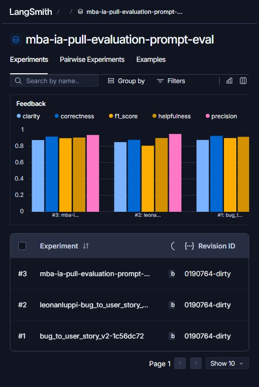

# MBA IA · Prompt Engineering

Projeto em Python, LangChain e LangSmith que transforma relatos de bugs em User Stories com critérios de aceitação verificáveis. O fluxo baixa o prompt público original, publica a v2 do YAML e avalia o prompt publicado nos 15 casos do curso.

## Técnicas Aplicadas (Fase 2)

- **Few-shot Learning.** Três pares de entrada e saída mostram como a resposta muda com a informação disponível. O filtro de um catálogo exemplifica uma história simples. A importação de estoque mostra critérios separados para validação e gravação. O relato “Deu erro ontem” demonstra como pedir os dados essenciais antes de propor uma história.
- **Role Prompting.** A persona de Product Manager sênior dá ao modelo a responsabilidade de traduzir o incidente em valor para o usuário e em critérios que QA consegue verificar. Na importação, por exemplo, a história expressa a necessidade de saber quais linhas foram gravadas e os critérios descrevem o que o painel deve exibir.
- **Skeleton of Thought.** A estrutura começa com persona, comportamento e benefício, seguida dos critérios no formato Dado/Quando/Então. Casos complexos ganham contexto e tarefas sugeridas. Quando a regra de negócio é incerta, a seção “A Confirmar” registra a decisão em aberto, como permitir importação parcial ou bloquear toda a planilha.

## Resultados Finais

| Aspecto | v1 | v2 |
| --- | --- | --- |
| Mensagens | O relato é interpolado no sistema e repetido na mensagem do usuário. | As regras e os exemplos ficam no sistema. A mensagem de usuário recebe o relato uma única vez. |
| Instruções | Um assistente genérico recebe o pedido de criar uma história. | A persona orienta a escolha da história e exige critérios observáveis em Markdown. |
| Escopo | A resposta fica a cargo do modelo. | A estrutura diferencia casos simples, falhas relacionadas e relatos insuficientes. A v2 pede que o modelo preserve fatos e sinalize hipóteses e dados a confirmar. |
| Exemplos | Ausentes. | Três pares próprios, fora do dataset de avaliação. |

As duas versões foram avaliadas nos mesmos 15 exemplos, com `gpt-4.1-mini` tanto na geração quanto no julgamento. A v2 publicada passou em cada métrica e atingiu média geral de **0,9076**.

| Métrica | v1 original | v2 publicada | Variação |
| --- | ---: | ---: | ---: |
| Helpfulness | 0,9033 | 0,9073 | +0,0040 |
| Correctness | 0,8814 | 0,9180 | +0,0366 |
| F1-Score | 0,8094 | 0,8979 | +0,0885 |
| Clarity | 0,8533 | 0,8767 | +0,0234 |
| Precision | 0,9533 | 0,9380 | −0,0153 |
| **Média geral** | **0,8801** | **0,9076** | **+0,0275** |

O F1-Score teve o maior ganho. A Precision caiu 0,0153 na rodada oficial e permaneceu acima de 0,8. Foram três experimentos no mesmo dataset, com uma rodada para a v1 e duas para o mesmo conteúdo da v2. A rodada inicial da v2 foi executada com o prompt privado enquanto o handle era ativado e obteve média de 0,9176. A rodada oficial usou `python src/evaluate.py` com o prompt público no commit `e9a1c83c`.

- [Prompt v2 público no LangSmith Hub](https://smith.langchain.com/hub/mba-ia-pull-evaluation-prompt/bug_to_user_story_v2)
- [Dataset público com os 15 exemplos e os três experimentos](https://smith.langchain.com/public/eb9876ea-4409-4a85-8d14-40df1bddc579/d)
- [Experimento oficial da v2 no workspace](https://smith.langchain.com/o/7682602c-6b74-45a0-9f6b-b5e5bc208ce4/datasets/68d64d2e-cb46-4278-80cc-a58213a03d6e/compare?selectedSessions=e8155866-5b5b-4d97-9c8c-1b1387813f3a)
- Traces públicos da v2 inicial por complexidade. [Simples](https://smith.langchain.com/public/cf20ccdb-0197-4c8d-9df1-283fc0b56228/r) · [Médio](https://smith.langchain.com/public/451b014b-9e79-4947-b2e8-b2b26eb92f95/r) · [Complexo](https://smith.langchain.com/public/bffd88eb-e75b-4b3e-b261-db2293878dec/r)



[Captura dos exemplos](screenshots/langsmith-dataset.jpg) · [Captura de um trace](screenshots/langsmith-trace.jpg)

## Como Executar

### 1. Ambiente e credenciais

Use Python 3.10 ou superior, Git, uma conta LangSmith e acesso à API da OpenAI ou do Google. O ambiente local foi validado com Python 3.13. Execute os comandos na raiz do fork.

```powershell
python -m venv venv
.\venv\Scripts\Activate.ps1
python -m pip install -r requirements.txt
Copy-Item .env.example .env
```

No Linux ou macOS, ative com `source venv/bin/activate` e copie com `cp .env.example .env`. Se o PowerShell impedir a ativação, rode os comandos Python usando `.\venv\Scripts\python.exe`.

- Configure `LANGSMITH_API_KEY`, `LANGSMITH_PROJECT` e `USERNAME_LANGSMITH_HUB`. O handle é a parte anterior a `/nome_do_prompt` no endereço público. Se precisar criá-lo, abra um prompt no LangSmith, use **Make Public** e escolha o handle definitivo. [LangSmith Prompts](https://smith.langchain.com/prompts)
- Configure `LLM_PROVIDER=openai` com `OPENAI_API_KEY` ou `LLM_PROVIDER=google` com `GOOGLE_API_KEY`. Preencha `LLM_MODEL` e `EVAL_MODEL` com modelos disponíveis na sua conta e que aceitem `temperature=0`, usado pelo avaliador do curso. Para OpenAI, `gpt-4.1-mini` na geração e `gpt-4.1` no julgamento são uma configuração inicial enquanto estiverem disponíveis. [Modelos OpenAI](https://developers.openai.com/api/docs/models) · [Descontinuações OpenAI](https://developers.openai.com/api/docs/deprecations) · [Modelos Gemini](https://ai.google.dev/gemini-api/docs/models)
- Mantenha `LANGSMITH_TRACING=true` para registrar as chamadas. O Git ignora o arquivo `.env`.

### 2. Baixar, validar, publicar e avaliar

```sh
python src/pull_prompts.py
python -m pytest tests/test_prompts.py
python src/push_prompts.py
python src/evaluate.py
```

1. O pull grava a v1 em `prompts/bug_to_user_story_v1.yml`. A v2 está em `prompts/bug_to_user_story_v2.yml`.
2. O push cria ou atualiza `<handle>/bug_to_user_story_v2`, confirma a visibilidade pública e imprime o endereço do commit do prompt. Abra o endereço para conferir o conteúdo no Hub.
3. O avaliador cria ou reutiliza `<LANGSMITH_PROJECT>-eval` no LangSmith e registra cinco notas por exemplo. A aprovação exige que cada métrica e a média geral atinjam 0,8. Em cada iteração, abra os exemplos com nota baixa, leia os comentários dos juízes, ajuste o YAML e repita o push e a avaliação. Mantenha os mesmos modelos para comparar versões.
4. Para compartilhar o dataset com os experimentos, rode uma vez e guarde o endereço retornado.

```sh
python -c "import os; from dotenv import load_dotenv; from langsmith import Client; load_dotenv(); print(Client().share_dataset(dataset_name=os.environ['LANGSMITH_PROJECT'] + '-eval')['url'])"
```

No dashboard, capture a lista dos 15 exemplos, o resumo com as cinco notas e o tracing detalhado de pelo menos três casos. Um caso simples, um médio e um complexo mostram a variação de formato da v2.
